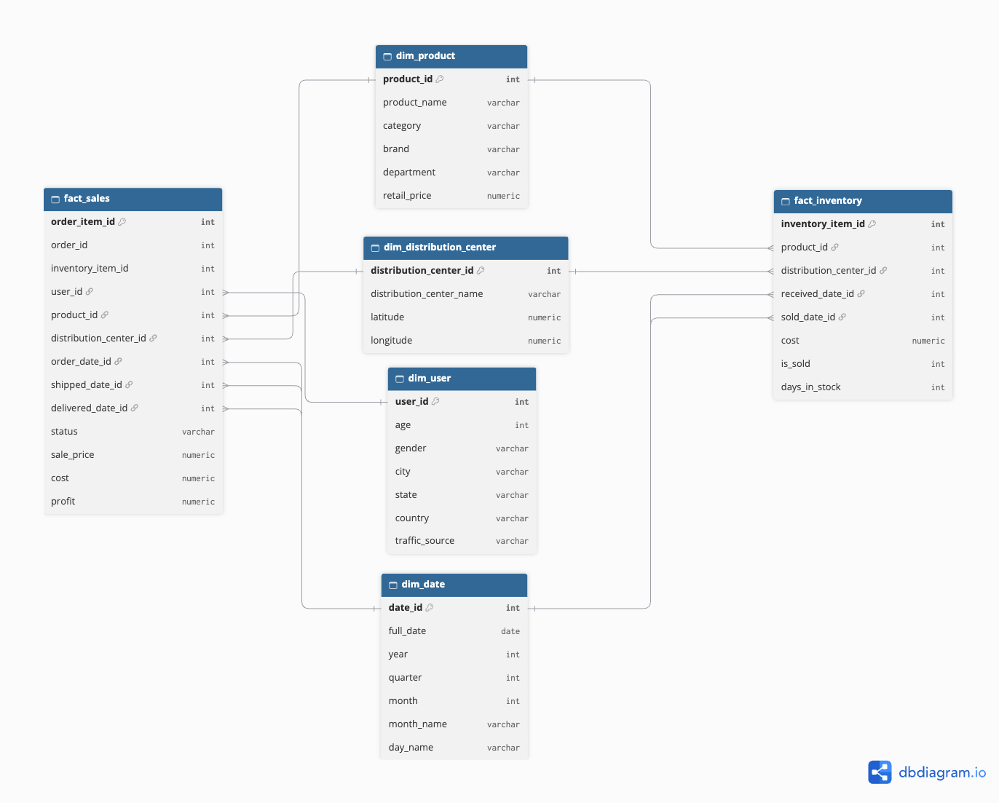

# ETL The Look: Sales and Stock Data Warehouse

## Summary

The Look is an e-commerce company whose sales data and stock data are stored separately, so it is hard to see which products sell fast and which stay unsold in its distribution centers. This project builds an ETL pipeline that extracts 2025 data from BigQuery, transforms it with PySpark, and loads it into a PostgreSQL data warehouse designed as a galaxy schema (2 fact tables and 4 dimension tables). The warehouse is then queried with SQL to answer the business questions.

Built as Graded Challenge 6 of the Hacktiv8 Data Analytics Bootcamp.

## Project Files

```
thelook-ecommerce-data-warehouse/
├── thelook_etl_data_warehouse.ipynb    # Extract, transform, load, and analysis
├── thelook_presentation.pptx           # Presentation slides
├── sql/
│   ├── extract_thelook_queries.sql     # BigQuery queries used to create the CSV files
│   ├── 01_create_database.sql          # Creates the thelook_dwh database
│   └── 02_create_tables.sql            # Creates the fact and dimension tables
├── data/                               # CSV files extracted from BigQuery
├── images/
│   └── galaxy_schema.png               # Data warehouse schema diagram
├── .env.example                        # Template for database credentials
└── LICENSE
```

## Workflow

1. **Extract:** run the queries in `sql/extract_thelook_queries.sql` in BigQuery (`bigquery-public-data.thelook_ecommerce`) and save each result as a CSV file in `data/`.
2. **Transform:** read the CSV files into PySpark, clean them, and build the fact and dimension tables.
3. **Load:** write the tables into PostgreSQL using a JDBC connection.
4. **Analyze:** query the warehouse with SQL to answer the business questions.

## Data Modeling

The warehouse uses a **galaxy schema** because two fact tables share the same dimensions.



| Table | Type | Grain / purpose |
|---|---|---|
| `fact_sales` | Fact (main) | One row per order item (price, cost, profit, status, dates) |
| `fact_inventory` | Fact (supporting) | One row per stock unit received (cost, sold or not, days in stock) |
| `dim_product` | Dimension | Product name, category, brand, department, retail price |
| `dim_distribution_center` | Dimension | Distribution center name and location |
| `dim_user` | Dimension | Customer age, gender, location, traffic source |
| `dim_date` | Dimension | Calendar dates (date_id in yyyyMMdd format), shared by both fact tables |

## Data and Cleaning

The data comes from the public BigQuery dataset `thelook_ecommerce`, limited to orders and stock received in 2025.

| File | Rows | Used for |
|---|---|---|
| `order_items_2025.csv` | 41,019 | `fact_sales` |
| `inventory_items_2025.csv` | 87,625 | `fact_inventory` |
| `products.csv` | 29,120 | `dim_product`, plus cost and distribution center for `fact_sales` |
| `users_2025.csv` | 24,327 | `dim_user` |
| `distribution_centers.csv` | 10 | `dim_distribution_center` |

| Step | Why |
|---|---|
| Renamed `id` columns (for example `id` to `product_id`) | Keeps column names consistent between facts and dimensions |
| Filled missing product names (2), brands (24), and cities (244) with 'Unknown' | Keeps these rows in the warehouse instead of dropping them |
| Kept null `shipped_at`, `delivered_at`, and `sold_at` as null | A null date means the order has not shipped or been delivered, or the stock is not sold yet |
| Converted timestamp columns to date type | Dates are stored as text in the raw files |
| Rounded cost and sale price to 2 decimals | Matches the `NUMERIC(10, 2)` columns in PostgreSQL |
| Checked for duplicate rows and IDs, and for orders or stock without a matching product | None were found, so no rows were removed |

New columns created during the transformation:
- `profit` = `sale_price` - `cost`
- `is_sold` = 1 if the stock unit was sold, 0 if not
- `days_in_stock` = days between received date and sold date (null if unsold)
- Date IDs in yyyyMMdd format, and `dim_date` built from every order, shipped, delivered, received, and sold date

## How to Run

**Requirements:** Python 3, Java (needed by PySpark), PostgreSQL, and the packages `pyspark`, `pandas`, and `python-dotenv`.

1. Clone the repository:
   ```bash
   git clone https://github.com/nardanov04/thelook-ecommerce-data-warehouse.git
   cd thelook-ecommerce-data-warehouse
   ```
2. Install the packages:
   ```bash
   pip install pyspark pandas python-dotenv
   ```
3. Copy `.env.example` to `.env` and fill in your PostgreSQL details.
4. In PostgreSQL, run `sql/01_create_database.sql` (connected to the default `postgres` database), then run `sql/02_create_tables.sql` (connected to `thelook_dwh`).
5. Run `thelook_etl_data_warehouse.ipynb` from top to bottom. The first run downloads the PostgreSQL JDBC driver, so it needs an internet connection.

The CSV files are already in `data/`. To recreate them, run the queries in `sql/extract_thelook_queries.sql` in BigQuery (requires a Google account).

To run the notebook again, run `sql/02_create_tables.sql` first. The load step appends rows, so old rows would cause duplicate key errors.

## Findings

- **Selling speed is similar across categories.** Sold stock took 28.9 to 32.5 days on average to sell. Dresses sold fastest (28.9 days) and Jumpsuits & Rompers slowest (32.5 days).
- **More than half of the stock is unsold.** 45,075 of the 87,625 stock units received in 2025 are unsold, and every distribution center has more than 50% unsold stock.
- **Unsold shares are close across distribution centers.** Mobile AL has the highest unsold share (52.46%), followed by Savannah GA (52.00%). The lowest is Port Authority of New York/New Jersey (50.91%).

## Conclusion

The warehouse joins sales and stock data, so selling speed and unsold stock can be analyzed by product, category, and distribution center. Selling speed barely differs between categories, and unsold stock is above 50% everywhere, which points to overstocking or weak demand across the network rather than one problem location.

## Recommendations

- Review purchasing and restocking volumes, since over half of the stock received in 2025 is unsold in every distribution center.
- Look first at Mobile AL and Savannah GA, which have the highest unsold shares.
- Extend the analysis to unsold stock by category, brand, and product to find which items need marketing support and which can be restocked with priority.

## Limitations

- "Unsold" means not sold in the data up to March 2026, so stock received late in 2025 had less time to sell.
- `days_in_stock` only exists for sold units, so it understates how long unsold units sit in stock.
- Only orders and stock received in 2025 are included.
- The dataset is a public sample dataset, and some rows have shipped dates before order dates. These were kept as they are in the source.

## Presentation

Slides: [Google Slides](https://docs.google.com/presentation/d/1Zu3Ibv2xWMqKQh6wzns-6HijVluTHalrsG3QBMuzrBE/edit?usp=sharing) (also available as `thelook_presentation.pptx`)

## Tools

Python, PySpark, pandas, SQL, Google BigQuery, PostgreSQL, Jupyter Notebook, Git and GitHub